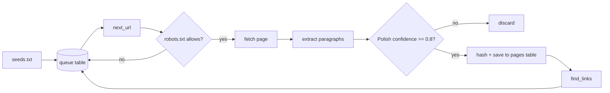

# polish-corpus-crawler

A polite, resumable web crawler that builds a **Polish text corpus** and stores it in SQLite.

Developed for the **Multilingual Intelligent Mind Service Lab (Mi2S)**, Department of Computer Science and Information Engineering (CSIE), National Cheng Kung University (NCKU), as the first step of adding **Polish** to the lab's multilingual speech and language project.

---

## Table of contents

- [Project context](#project-context)
- [What the crawler does](#what-the-crawler-does)
- [How it works](#how-it-works)
- [Requirements and installation](#requirements-and-installation)
- [Quick start](#quick-start)
- [Command-line options](#command-line-options)
- [Running on the lab server](#running-on-the-lab-server)
- [Output: the database](#output-the-database)
- [Configuration constants](#configuration-constants)
- [Politeness and ethics](#politeness-and-ethics)
- [Design decisions](#design-decisions)
- [Known limitations](#known-limitations)
- [Roadmap](#roadmap)
- [Project structure](#project-structure)
- [Author and acknowledgements](#author-and-acknowledgements)

---

## Project context

The Mi2S lab, led by Prof. Wen-Hsiang Lu, develops multilingual speech and language technology. The current system performs **speech-to-text and translation** between:

- Taiwanese (Hokkien)
- Hakka
- Indonesian
- English
- Vietnamese

**Polish** is being added as a new language.

### Long-term vision

The lab's long-term goal is an AI that can **recognise emotion from audio alone and reproduce it in synthesized speech**. The intended application is **hospital and care settings**, for example:

- patients who do not speak Chinese, including some Indigenous-language speakers,
- elderly patients who need communication and companionship.

### Where this repository fits

A new language needs data before it needs models. This crawler is the **first building block for Polish**: it collects a large, clean, language-verified set of Polish text that can later be used for language modelling, vocabulary and frequency analysis, translation data and further NLP work.

> This repository contains **text collection only**. It does not include speech data, models or any medical functionality.

---

## What the crawler does

Starting from a list of seed websites, the crawler:

1. downloads pages politely (respecting `robots.txt` and per-site delays),
2. extracts the main paragraphs of text,
3. checks that the text is genuinely **Polish** using a language detector,
4. removes duplicate content,
5. saves the result to a SQLite database with metadata,
6. follows links only from Polish pages, so it stays inside the Polish web.

Key properties:

| Property | How it is achieved |
|---|---|
| **Resumable** | The crawl queue is stored in SQLite. Stop with Ctrl+C and run again to continue. |
| **Polite** | `robots.txt`, `Crawl-delay`, per-domain delay, honest User-Agent with contact info, automatic backoff. |
| **Polish-focused** | Language detection on every page; links are followed only from Polish pages (and seeds). |
| **Diverse** | Breadth-first order and a cap of 3000 queued URLs per domain. |
| **Deduplicated** | `UNIQUE` constraints on URL and on a content hash. |
| **Crash-safe** | Progress is committed after every page. |
| **Low-dependency** | Only three third-party packages; everything else is the Python standard library. |

---

## How it works



### Pipeline in detail

1. **Frontier (`queue` table).** All URLs to visit are stored with their domain, depth and a `done` flag.
2. **Scheduling (`next_url`).** Picks the shallowest, oldest unvisited URL from a domain that is *not* currently cooling down. While one site rests, the crawler works on another, so politeness does not waste time.
3. **robots.txt (`allowed`).** Fetched once per domain and cached. A missing file (4xx) means everything is allowed. A server error or unreachable host means the crawler stays away.
4. **Download (`fetch`).** Only HTML pages up to 5 MB. Handles timeouts, `403`/`429` responses, per-domain bans and a global pause after many consecutive errors.
5. **Extraction (`save`).**
   - Removes `script`, `style`, `noscript`, `nav`, `header`, `footer`, `aside` and `form` elements.
   - Keeps `<p>` paragraphs of at least 40 characters.
   - Requires at least 300 characters of text in total.
6. **Language check.** The first 3000 characters are scored with [lingua](https://github.com/pemistahl/lingua-py). The page is kept only if the Polish confidence is at least **0.8**.
7. **Deduplication.** An MD5 hash of the normalised text (lowercased, whitespace collapsed) must be new.
8. **Link extraction (`find_links`).** Links are made absolute, fragments removed, and junk filtered out: non-HTML files, login/cart/account pages, noisy query parameters, URLs over 300 characters.
9. **Loop (`run`).** Repeats until the time limit, the page limit, or an empty queue.

### Language detector

The detector is restricted to 11 languages: Polish, English, German, Russian, Ukrainian, Czech, Slovak, Lithuanian, French, Spanish and Italian.

The confidence is *relative* to this set (the probabilities add up to 1), so the detector needs competitors to compare Polish against. The set includes the Slavic and neighbouring languages most easily confused with Polish, plus the languages most common on the Polish web.

---

## Requirements and installation

- Python **3.9+**
- Packages: `requests`, `beautifulsoup4`, `lingua-language-detector`

```bash
git clone <repository-url>
cd polish-corpus-crawler

python3 -m venv .venv
source .venv/bin/activate          # Windows: .venv\Scripts\activate

pip install requests beautifulsoup4 lingua-language-detector
```

Or, with a `requirements.txt`:

```text
requests
beautifulsoup4
lingua-language-detector
```

```bash
pip install -r requirements.txt
```

The first start takes a few seconds while lingua loads its language models.

---

## Quick start

### 1. Create `seeds.txt`

One URL per line. Lines starting with `#` are ignored.

```text
# Polish seed pages (examples)
https://pl.wikipedia.org/wiki/Polska
https://www.polskieradio.pl/
```

Good seeds are Polish-language sites with a lot of prose (news, encyclopedias, blogs) that link to many other Polish sites.

### 2. Run a small test

```bash
python main.py --max-pages 20 --log crawl.log
```

### 3. Inspect the result

```bash
sqlite3 polish_corpus.db
```

```sql
SELECT COUNT(*) FROM pages;
SELECT url, n_words, polish_confidence FROM pages LIMIT 10;
```

### 4. Run a real crawl

```bash
python main.py --hours 10 --log crawl.log
```

Stop at any time with **Ctrl+C**. Run the same command again to **continue** from the saved queue.

---

## Command-line options

| Option | Default | Description |
|---|---|---|
| `--hours` | `0` | Stop after this many hours (`0` = no limit). |
| `--max-pages` | `0` | Stop after this many download attempts (`0` = no limit). |
| `--db` | `polish_corpus.db` | SQLite database file (created if missing). |
| `--seeds` | `seeds.txt` | File with seed URLs. |
| `--delay` | `1.0` | Seconds to sleep after **every** request (global speed limit). |
| `--domain-delay` | `3.0` | Minimum seconds between requests to the **same** site. A site's own `Crawl-delay` is used if it is larger. |
| `--log` | *(none)* | Write the log to this file instead of the terminal. |

Example:

```bash
python main.py --hours 8 --delay 0.2 --domain-delay 3 --db polish_corpus.db --log crawl.log
```

> Lowering `--delay` speeds up the crawl overall without making it harder on any single site, because the per-site limit is controlled by `--domain-delay`. Keep `--domain-delay` at 3 seconds or higher.

---

## Running on the lab server

A long crawl should run on a machine that stays on. Use `tmux` so it survives disconnects:

```bash
ssh <your-server-alias>
cd polish-corpus-crawler

tmux new -s crawl
python3 main.py --hours 10 --log crawl.log
# detach: Ctrl+B, then D
```

Come back later:

```bash
ssh <your-server-alias>
tmux attach -t crawl
tail -f crawl.log
```

Copy the database to your own computer:

```bash
scp <your-server-alias>:~/polish-corpus-crawler/polish_corpus.db .
```

Please check with the lab administrator how much disk space and bandwidth the crawl may use.

---

## Output: the database

The crawler creates one SQLite file with two tables.

### `pages` (the corpus)

| Column | Description |
|---|---|
| `id` | Auto-increment primary key. |
| `url` | Final URL after redirects (`UNIQUE`). |
| `domain` | Host name, e.g. `pl.wikipedia.org`. |
| `title` | Contents of the HTML `<title>`, if any. |
| `text` | Extracted text, one paragraph per line. |
| `n_chars` | Number of characters in `text`. |
| `n_words` | Number of whitespace-separated words. |
| `polish_confidence` | Detector confidence for Polish (0 to 1). |
| `text_hash` | MD5 of the normalised text (`UNIQUE`, used for deduplication). |
| `fetched_at` | UTC timestamp (ISO 8601). |

### `queue` (the crawl frontier)

| Column | Description |
|---|---|
| `id` | Auto-increment key; also the arrival order. |
| `url` | URL to visit (`UNIQUE`). |
| `domain` | Host name, used for politeness and per-domain caps. |
| `depth` | Link-hops from a seed (seeds = 0). |
| `done` | `0` = waiting, `1` = handled. |

Rows are never deleted from `queue`, so a URL can never be queued twice and the crawler can resume exactly where it stopped.

### Useful queries

```sql
-- corpus size
SELECT COUNT(*) AS pages, SUM(n_words) AS words FROM pages;

-- which domains contribute most
SELECT domain, COUNT(*) AS n, SUM(n_words) AS words
FROM pages GROUP BY domain ORDER BY n DESC LIMIT 20;

-- crawl progress
SELECT done, COUNT(*) FROM queue GROUP BY done;

-- low-confidence pages worth a manual look
SELECT url, polish_confidence FROM pages
WHERE polish_confidence < 0.9 ORDER BY polish_confidence LIMIT 20;
```

### Export to JSONL

```python
import json
import sqlite3

db = sqlite3.connect("polish_corpus.db")
with open("polish_corpus.jsonl", "w", encoding="utf-8") as out:
    for url, domain, title, text in db.execute(
        "SELECT url, domain, title, text FROM pages"
    ):
        record = {"url": url, "domain": domain, "title": title, "text": text}
        out.write(json.dumps(record, ensure_ascii=False) + "\n")
```

---

## Configuration constants

Defined at the top of `main.py`:

| Constant | Value | Meaning |
|---|---|---|
| `USER_AGENT` | `UniResearchBot/0.1 (...)` | Identifies the bot and gives a contact address. |
| `MIN_CHARS` | `300` | Minimum extracted text length. |
| `MIN_POLISH_CONFIDENCE` | `0.8` | Minimum language confidence to keep a page. |
| `MAX_PAGES_PER_DOMAIN` | `3000` | Maximum URLs queued per domain (diversity and crawler-trap protection). |
| `MAX_FAILS_PER_DOMAIN` | `5` | Number of `403`/`429` responses before a domain is skipped. |
| `SKIP_EXTENSIONS` | tuple | File types never downloaded (images, archives, media, Office files, CSS/JS, feeds). |
| `BAD_URL` | regex | Query parameters and paths that are skipped (sorting and session parameters, login, cart, account pages, in English and Polish). |

---

## Politeness and ethics

- **Honest identification.** The User-Agent names the bot and gives a contact address, so site owners can reach the author.
- **robots.txt is always checked** before a page is downloaded, and `Crawl-delay` is honoured.
- **Rate limiting.** At least 3 seconds between requests to the same site, plus a global delay.
- **Backoff.** A `429` response pauses the crawler. After 5 failures a domain is skipped. After 20 consecutive network errors the crawler pauses for 5 minutes.
- **Scope.** Only HTML pages are downloaded. Login, cart and account pages are avoided.
- **Copyright.** Collected pages remain the property of their authors. The corpus is intended for **research use within the lab**. Do not redistribute the raw text publicly without checking the licence of the sources.

---

## Design decisions

| Choice | Reason | Trade-off |
|---|---|---|
| **Python** | Best NLP ecosystem; crawling is network-bound, not CPU-bound. | Slower than Go/Rust for heavy parsing. |
| **requests** | Simple, reliable, connection reuse. | Synchronous, no HTTP/2. Async or Scrapy would scale better. |
| **BeautifulSoup + html.parser** | Forgiving with broken HTML; no extra dependency; handles legacy Polish encodings when given raw bytes. | Slower than `lxml`. |
| **lingua** | High accuracy on short and mixed text; real confidence scores; restrictable language set. | Heavier than fastText or langid. |
| **SQLite** | Zero setup, one file, transactions, `UNIQUE` constraints for free deduplication, resumable queue. | One writer at a time; not distributed. |
| **MD5 content hash** | Fast exact-duplicate detection. | Does not catch near-duplicates. |
| **Breadth-first + per-domain cap** | Spreads the crawl over many sites. | Large single sites are only partially covered. |
| **`urllib.robotparser`** | Standard library. | No `*` / `$` wildcard support in rules. |

---

## Known limitations

- **Navigation links are not followed.** Boilerplate tags (`nav`, `header`, `footer`, `aside`) are removed *before* links are extracted, so menu and category links never enter the queue. Extracting links first would fix this.
- **`www.site.pl` and `site.pl` count as different domains**, so politeness delays and the per-domain cap are applied separately.
- **Only `<p>` elements are extracted.** Text inside `<div>`, lists, tables and headings is missed, and cookie-banner paragraphs can slip in.
- **Exact duplicates only.** Near-duplicate and paragraph-level boilerplate removal is not implemented.
- **Language confidence is relative to 11 languages.** Pages in other Slavic languages (Croatian, Slovenian, Belarusian, ...) could occasionally be scored as Polish.
- **No retries.** A URL that times out or returns a server error is marked as done.
- **A `429` pauses the whole crawler** for 60 seconds, not just the affected domain.
- **The `saved` counter in the log includes duplicates** that the database silently ignored.
- **Single-threaded.** Throughput is roughly 3,000 pages per hour with default settings.
- **Written web text only.** The corpus reflects written, mostly formal Polish.

---

## Roadmap

- [ ] Extract links before removing boilerplate (follow navigation links)
- [ ] Normalise domains (`www.` prefix) and URLs
- [ ] Faster crawling: lower global delay, thread pool, `lxml` parser, batched commits
- [ ] Per-domain cooldown instead of a global pause on `429`
- [ ] Retries with backoff for transient errors
- [ ] Better content extraction (e.g. `trafilatura` or `jusText`)
- [ ] Near-duplicate detection (SimHash / MinHash)
- [ ] Paragraph-level boilerplate and cookie-text filtering
- [ ] Export script and corpus statistics (words, domains, topics)
- [ ] Domain-specific seeds for the lab's use cases (conversational and health-related Polish)
- [ ] Polish speech data collection for the speech-to-text part of the project

---

## Project structure

```text
polish-corpus-crawler/
├── main.py            # the crawler (single file)
├── seeds.txt          # seed URLs, one per line
├── requirements.txt   # Python dependencies
├── README.md
├── .gitignore
├── polish_corpus.db   # generated: the corpus (not committed)
└── crawl.log          # generated: log file (not committed)
```

Recommended `.gitignore`:

```text
*.db
*.log
__pycache__/
.venv/
```

---

## Author and acknowledgements

- **Author:** *Mikołaj Żyszkiewicz*, *National Cheng Kung University*
- **Contact:** *mikolaj.zyszkiewicz1@gmail.com*
- **Lab:** Multilingual Intelligent Mind Service Lab (Mi2S), Department of CSIE, National Cheng Kung University
- **Supervisor:** Prof. Wen-Hsiang Lu

Built with [requests](https://requests.readthedocs.io/), [Beautiful Soup](https://www.crummy.com/software/BeautifulSoup/) and [lingua-py](https://github.com/pemistahl/lingua-py).

## License

*Internal research use, all rights reserved*
